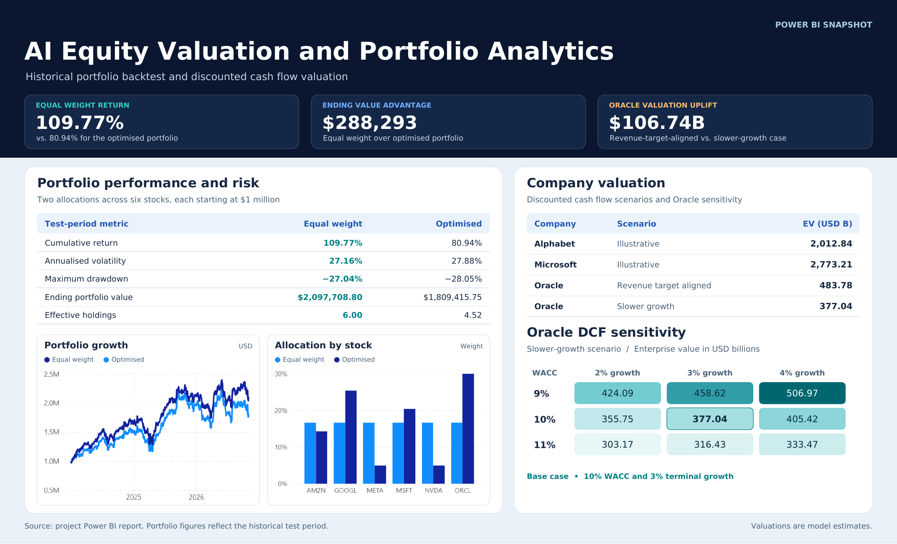

# AI Equity Valuation and Portfolio Analytics

A financial modelling and portfolio research project that estimates enterprise value for Oracle, Microsoft, and Alphabet, then evaluates how two allocations across six AI-exposed stocks performed in a historical test. The project uses **Python, SQLite, R, and Power BI** to model the results, check them, and communicate the findings.

## Problem and project objectives

An AI-related revenue target does not tell an analyst how much cash a company can generate. Faster growth can require substantial reinvestment, and the estimated value can shift when the discount rate or long-run growth assumption changes. At the portfolio level, an allocation produced by an optimiser can also concentrate exposure in a few names. The historical test measures whether that allocation actually delivered better returns or lower risk than equal weighting over the period studied.

The project addressed three questions.

1. **Valuation.** What enterprise values do the cash flow assumptions imply, and how much do Oracle's growth and reinvestment assumptions move the estimate?
2. **Portfolio construction.** How do equal-weight and optimised allocations compare on cumulative return, annualised volatility, maximum drawdown, and concentration?
3. **Validation and reporting.** Can the results be queried in SQLite, independently checked in R, and traced to the values displayed in Power BI?

## 1. Company valuation

The Python DCF models project revenue, estimate operating profit after tax, and subtract net reinvestment to calculate free cash flow to the firm (FCFF). Discounting the forecast cash flows and terminal value at the weighted average cost of capital (WACC) yields an enterprise value estimate.

### Valuation scenarios

| Company | Scenario | Model baseline date | Enterprise value (USD billions) |
| --- | --- | --- | ---: |
| Alphabet | Illustrative | 2025-12-31 | 2,012.84 |
| Microsoft | Illustrative | 2026-06-30 | 2,773.21 |
| Oracle | Revenue target aligned | 2027-05-31 | 483.78 |
| Oracle | Slower growth | 2027-05-31 | 377.04 |

Oracle's revenue-target-aligned scenario produced an enterprise value **$106.74 billion higher**, or about **28.3% above** the slower-growth case. In the target-aligned forecast, revenue reaches **$225.00 billion in FY2030**, while **$118.44 billion** of net reinvestment leaves FCFF at **−$55.83 billion** that year. FCFF turns positive in FY2031 as forecast net reinvestment falls. The forecast shows how a growth target can raise the modelled enterprise value while the investment needed to reach it weighs on near-term cash flow.

The Microsoft model separately tested **sales-to-capital ratios of 0.5, 1.0, and 1.5**. The corresponding enterprise value estimates were **$2,378.78 billion**, **$2,773.21 billion**, and **$2,904.68 billion**. A higher ratio means the model assumes more incremental sales per dollar of reinvestment.

### Oracle DCF sensitivity

The slower-growth scenario was tested across **nine combinations** of WACC and terminal growth. All figures in this grid are in **USD millions**.

| WACC | 2% terminal growth | 3% terminal growth | 4% terminal growth |
| ---: | ---: | ---: | ---: |
| 11% | 303,171.59 | 316,426.59 | 333,468.73 |
| 10% | 355,753.41 | **377,040.25** | 405,422.70 |
| 9% | 424,090.44 | 458,622.01 | 506,966.21 |

The estimates range from **$303.17 billion to $506.97 billion** across the assumptions tested. At **10% WACC and 3% terminal growth**, the heatmap value of **$377,040.25 million** reconciles to the **$377.04 billion** slower-growth estimate in the scenario table. Holding terminal growth at 3%, increasing WACC from 9% to 11% lowers the estimate from **$458.62 billion to $316.43 billion**.

## 2. Portfolio construction and historical test

The two portfolios start with **$1 million** and use the same six stocks: **AMZN, GOOGL, META, MSFT, NVDA, and ORCL**. Equal Weight allocates approximately **16.67%** to each stock. The Optimised allocation has its largest weights in Oracle, Alphabet, and Microsoft.

| Test-period metric | Equal Weight | Optimised |
| --- | ---: | ---: |
| Ending portfolio value | $2,097,708.80 | $1,809,415.75 |
| Cumulative return | 109.77% | 80.94% |
| Annualised volatility | 27.16% | 27.88% |
| Maximum drawdown | −27.04% | −28.05% |
| Weight concentration (sum of squared weights) | 0.167 | 0.221 |
| Effective holdings (inverse of concentration) | 6.00 | 4.52 |

Equal Weight finished **$288,293.05 ahead**, a cumulative return advantage of **28.83 percentage points**. It also experienced lower annualised volatility and a shallower peak-to-trough loss. Both portfolios held six stocks, but the Optimised portfolio's uneven weights reduced its effective holdings to **4.52**. In this test, that additional concentration coincided with lower returns and higher realised risk.

## 3. Data workflow and validation

| Stage | Tool | What it contributed |
| --- | --- | --- |
| Model and backtest | Python and Jupyter | Projected company cash flows, ran valuation scenarios and sensitivity tests, compared portfolio allocations, and exported daily balances and summary results. |
| Store and query results | SQLite | Stored company valuations, portfolio performance, and portfolio weights. SQL queries retrieved the scenario results and verified that each set of portfolio weights summed to **100%**. SQL also calculated concentration and effective holdings from the weights. |
| Recalculate risk independently | R | Imported **713 daily portfolio observations**, used the initial **$1 million** to calculate the first daily return, and annualised the sample standard deviation of daily returns using **√252**. The resulting **27.16%** and **27.88%** matched the Python results to two decimals. |
| Prepare and present results | Power Query and Power BI | Imported the exported results, reshaped the Oracle sensitivity grid into one record per WACC and growth combination, and used those records to build the report matrix and its colour gradient. |

## Power BI dashboard

### Portfolio Performance & Risk

The summary table shows the final return and risk metrics, the allocation chart identifies where the portfolios differ by stock, and the growth chart shows how their values evolved during the test.

### Company Valuation

The scenario table compares the modelled enterprise values in **USD billions**. The Oracle heatmap displays the nine WACC and terminal growth combinations in **USD millions**.

## How to review the project

1. Use the Jupyter notebooks to review the valuation assumptions, cash flow forecasts, and portfolio backtest.
2. Inspect the SQLite queries to trace the reported scenarios and verify the portfolio weights and concentration calculations.
3. Run the R check on the exported daily portfolio values to reproduce the reported annualised volatility.
4. Open the Power BI report in Power BI Desktop to explore both pages. If refreshing on another computer, update the paths to the exported CSV files in Power Query.

## Scope and interpretation

The enterprise values are conditional model estimates, and the company scenarios use different baseline dates. The Oracle sensitivity range reflects the nine assumptions tested. The portfolio comparison covers one historical test period and one six-stock universe, so the results describe how these two allocations behaved in that sample.
